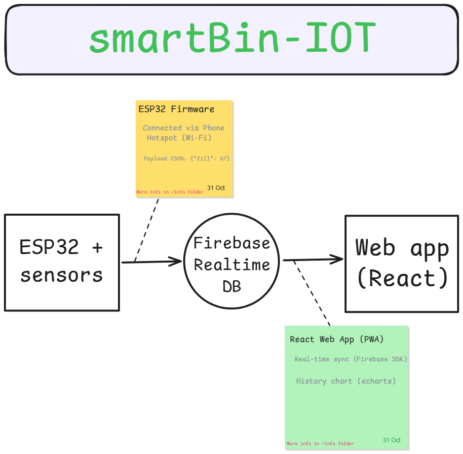

# smartBin-IOT-PW 🗑️
IoT Smart Trash Bin system with ESP32 firmware and React web dashboard

**Projekt zespołowy ( cos tu trzeba ladnie napisac ).**

## 🤖 Architektura Systemu
Poniższy schemat przedstawia przepływ danych pomiędzy mikrokontrolerem ESP32, chmurą a aplikacją kliencką:

